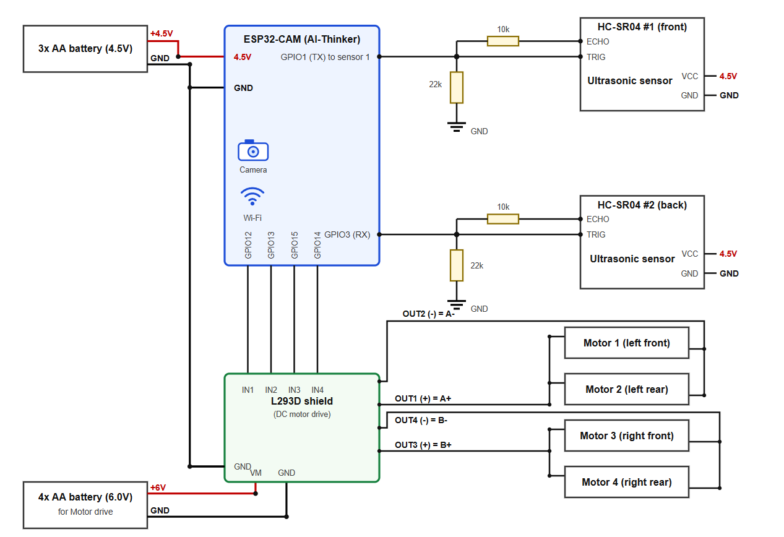
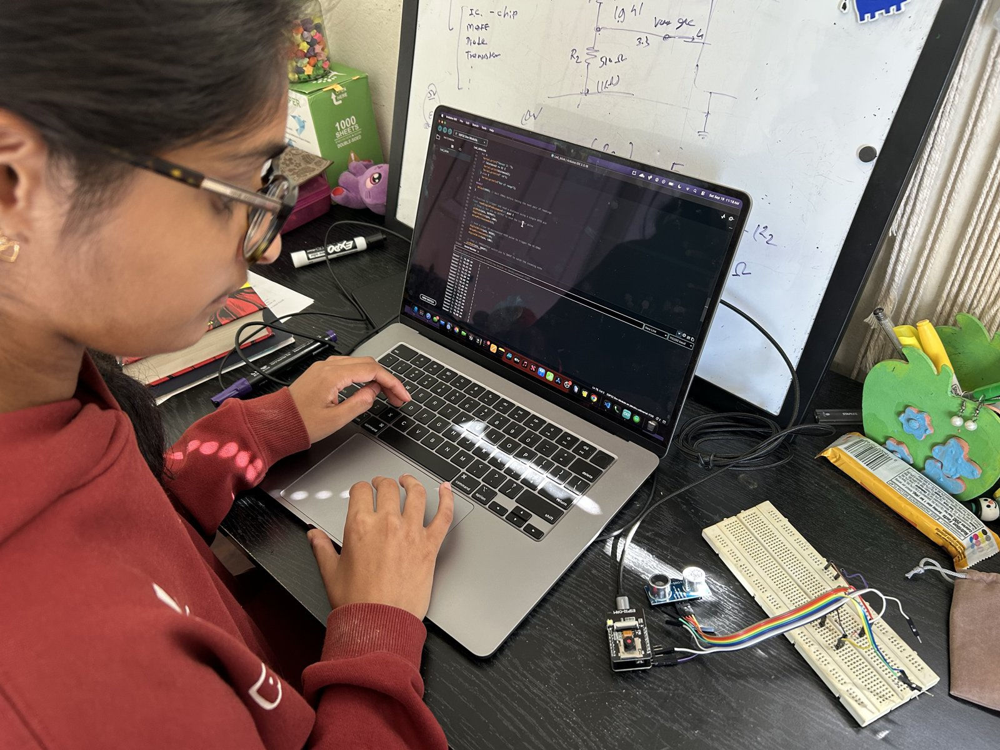
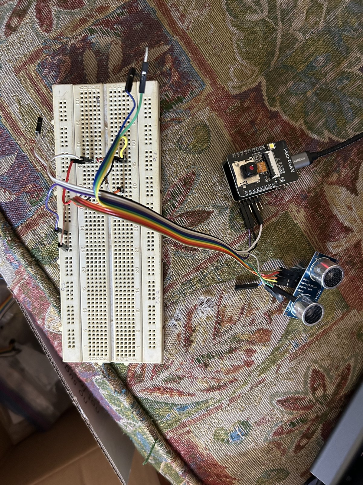
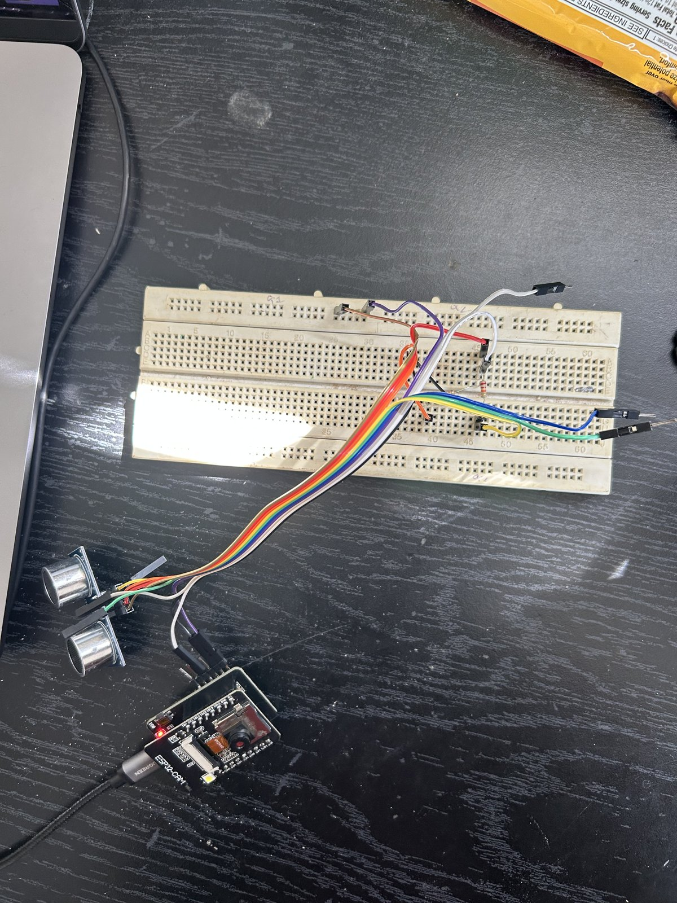
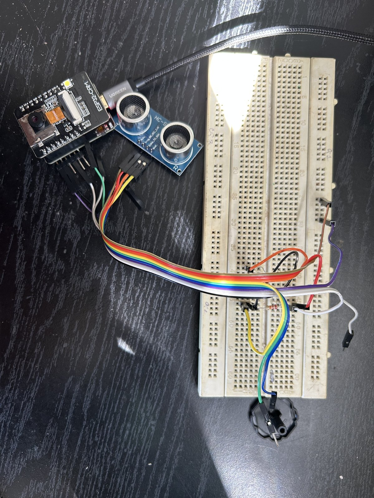
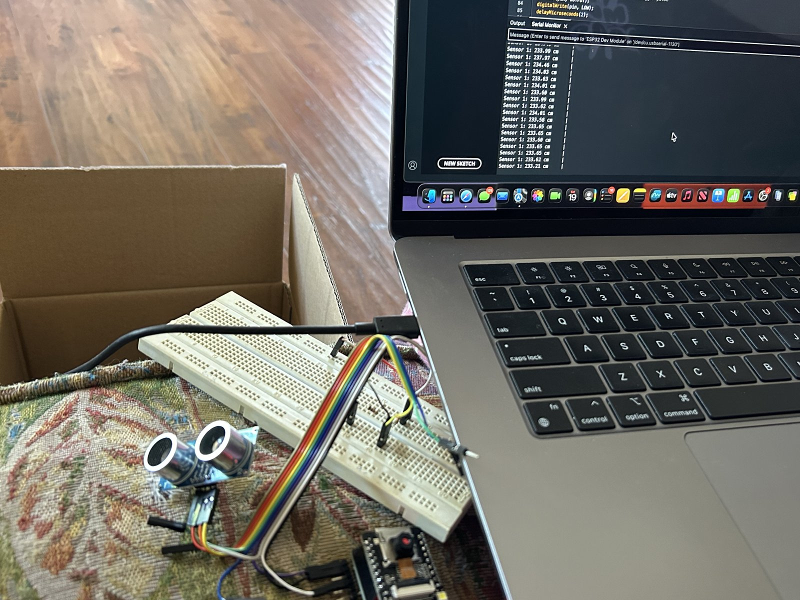
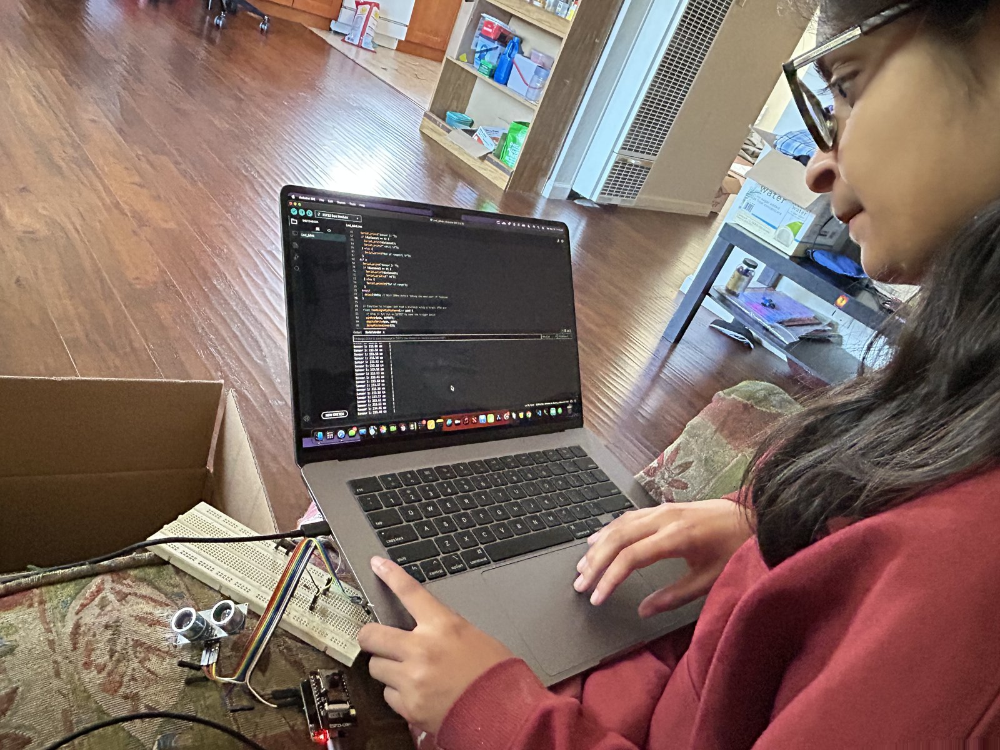

# ESP32-CAM Wi-Fi Robot Car — Step-by-Step Guide for Beginners

This guide follows the same path used to build this project, from zero experience to a robot car that you drive
from a phone browser while it streams live video and shows the distance from two ultrasonic sensors.

> **Note: how AI helped in this project**
>
> - **Code:** For code development and integration of all the sample code, I used [Google Gemini](https://gemini.google.com/), with lots of trial-and-error phases.
> - **Documentation:** I also used [Google Gemini](https://gemini.google.com/) for the documentation. It created a nice document based on my feedback, my experience, and the videos I recorded while building the project.
>
> As a beginner, I found AI very helpful in this project.

<p align="center"><br><em>Block diagram: ESP32-CAM, two HC-SR04 sensors, L293D motor driver, four motors, two battery packs</em></p>

<p align="center"><br><em>Building and debugging the project</em></p>

**What you will build**

- An **ESP32-CAM** (AI-Thinker) board that creates its own Wi-Fi network `ESP32-CAM-Robot`.
- A web page at **http://192.168.4.1** with live camera video, FW / LEFT / STOP / RIGHT / REV buttons and two
  distance readings.
- Four DC motors driven through an **L293D** motor driver, and two **HC-SR04** ultrasonic sensors (front and back).

**Files in this repository**

| File | What it is | Used in |
|---|---|---|
| `motor_test` | Motor-only sketch: drives forward 2 s, reverse 2 s, forever | Step 5 |
| `sensor_test` | Two HC-SR04 sensors on one pin each, prints distance to the Serial Monitor | Step 6 |
| `camera_and_wifi_streaming.ino` | Final combined code: Wi-Fi + camera stream + web buttons + sensors | Steps 7–8 |
| `Block_diagram.png` | Full wiring diagram | Steps 5–8 |
| `images/` | Project photos (JPEG copies of the HEIC photos in `ESP-32 CAM Picture/`) | This guide |
| `Nishi_Robot_Project_Guide.docx` | Project write-up: parts, pin map, how it works, challenges | All |

> `motor_test` and `sensor_test` have no file extension. The Arduino IDE needs each sketch in a folder with the same
> name, e.g. `motor_test/motor_test.ino`. Create the folder, copy the code in, and open the `.ino` file.

---

## Timeline (how this project was actually done)

| When | Step | What happened | Evidence |
|---|---|---|---|
| **11th grade** (school year) | 1. Research | Watched YouTube builds of ESP32-CAM robot cars; decided on the parts | — |
| **11th grade** | 2. Learn the tools | Installed the Arduino IDE, learned how to upload to an ESP32-CAM, tried the camera example | — |
| **Summer after 11th grade** | 3. Parts | Made the parts list and ordered everything online | — |
| **Summer after 11th grade** | 4. Breadboard basics | Learned breadboard, multimeter, voltage divider, L293D motor driver | — |
| **12th grade fall — Sept 2026** | 5. Motor test | Motor wiring + `motor_test` with AI-generated sample code, fixed pin mix-ups | commits 18–19 Sep 2026 |
| **Sept 2026** | 6. Sensor test | Two HC-SR04 sensors on one pin each + `sensor_test` | commits 19–20 Sep 2026 |
| **Sept–Oct 2026** | 7. Combine code | Camera streaming server + control page, then merged motors and sensors (sensors moved to TX/RX) | commits 20 Sep, 15 Oct 2026 |
| **Oct 2026** | 8. Full circuit | Whole robot on batteries, end-to-end debugging | commit 15 Oct 2026 |
| **Nov 2026** | 9. Document | Block diagram, project guide, this guide | commit 25 Nov 2026 |

**Suggested pace for a new student:** about 10–12 weeks at a few hours a week, plus 1–3 weeks of shipping time for parts.

| Week | Step |
|---|---|
| 1–2 | Step 1 Research + Step 2 Arduino IDE / ESP32-CAM camera example |
| 3 | Step 3 Order parts (start Step 4 videos while waiting) |
| 4 | Step 4 Breadboard, multimeter, voltage divider |
| 5–6 | Step 5 Motor test |
| 7 | Step 6 Sensor test |
| 8–9 | Step 7 Combine code with AI help |
| 10–11 | Step 8 Full circuit and debugging |
| 12 | Step 9 Demo video and documentation |

---

## Step 1 — Research on YouTube (11th grade)

Goal: see what an ESP32-CAM robot looks like, what parts others used, and what problems they hit. Watch 3–4
complete builds, then write down: board, motor driver, battery, sensors, and how the robot is controlled.

| Watch | Why |
|---|---|
| [ESP32-CAM Robot Car with Live Video Streaming](https://www.youtube.com/watch?v=sap6sQwenYE) | Complete build with web control (uses a TB6612FNG driver instead of L293D) |
| [ESP32 cam Smart Robot Car — WiFi camera remote control](https://www.youtube.com/watch?v=wCjUPXjQIIc) | Same idea, live video on phone |
| [DIY ESP32-CAM Spy Car That Streams LIVE Video (Full Build Guide)](https://www.youtube.com/watch?v=HkWLLC9Xego) | Full build from scratch |
| [WiFi Controlled Spy Robot Car using ESP32-Cam (Circuit Digest)](https://www.youtube.com/watch?v=W6qm61QcYmw) | Has a written page with code and circuit: [circuitdigest.com](https://circuitdigest.com/microcontroller-projects/esp32-cam-surveillance-car) |
| [ESP32-CAM Remote Control Car with Onboard Camera](https://www.youtube.com/watch?v=BwsH1kLxDmQ) | Toy RC car converted to ESP32-CAM |

Written reference worth reading: [DroneBot Workshop — Build an ESP32CAM Robot Car](https://dronebotworkshop.com/esp32cam-robot-car/).
It explains the main limit of this board: **most GPIO pins are used by the camera**, and GPIO 1/3 are the upload
(serial) pins. This project runs into exactly that problem in Step 7.

**Checkpoint:** a one-page note listing the parts you plan to use and a sketch of how they connect.

---

## Step 2 — Understand the Arduino IDE and the ESP32-CAM board (11th grade)

### 2.1 Install the Arduino IDE

| Watch / read | Why |
|---|---|
| [How to Install and Set Up Arduino IDE — Complete Beginner Guide](https://www.youtube.com/watch?v=K0GicSmWlww) | Download, install, first setup |
| [How to Use Arduino IDE Software (Step-by-Step for Beginners)](https://www.youtube.com/watch?v=dCh3pmMCfWg) | Tour of IDE 2.x: verify, upload, Serial Monitor |
| [Getting Started with Arduino IDE 2 (official docs)](https://docs.arduino.cc/software/ide-v2/tutorials/getting-started-ide-v2/) | Written reference |

### 2.2 Add ESP32 support

1. **File → Preferences → Additional boards manager URLs**, add
   `https://espressif.github.io/arduino-esp32/package_esp32_index.json`
2. **Tools → Board → Boards Manager**, search **esp32** (by Espressif Systems), Install.
3. **Tools → Board → esp32 → AI Thinker ESP32-CAM**.

### 2.3 Learn the ESP32-CAM board and how to upload to it

The ESP32-CAM has **no USB port**. You upload through a USB-to-serial adapter (FTDI or CH340):

| ESP32-CAM | FTDI adapter |
|---|---|
| 5V | VCC (5V) |
| GND | GND |
| U0R (GPIO3) | TX |
| U0T (GPIO1) | RX |
| GPIO0 → GND | (jumper wire, **only while uploading**) |

Upload routine: connect GPIO0 to GND → press RST → click Upload → when it says "Done uploading", remove the
GPIO0–GND wire → press RST to run the code.

| Watch / read | Why |
|---|---|
| [ESP32-Cam Quickstart with Arduino IDE](https://www.youtube.com/watch?v=HySmjq7npV4) | Board setup, upload, first live video |
| [ESP32-CAM: The Ultimate Guide to Image Capture and Streaming](https://www.youtube.com/watch?v=i4yG8vG1xrA) | Newer, full beginner walkthrough |
| [How to Upload Code to ESP32-CAM Using FTDI USB to TTL](https://www.youtube.com/watch?v=8O8aJfTyHTQ) | Wiring the programmer, GPIO0 trick |
| [How to Solve Code Uploading Errors In ESP32-Cam](https://www.youtube.com/watch?v=WjbdK4xAELk) | "Failed to connect" / timeout fixes |
| [Random Nerd Tutorials — Program / Upload Code to ESP32-CAM](https://randomnerdtutorials.com/program-upload-code-esp32-cam/) | Written step-by-step |
| [Random Nerd Tutorials — ESP32-CAM AI-Thinker Pinout](https://randomnerdtutorials.com/esp32-cam-ai-thinker-pinout/) | Which pins are free and which are risky |

### 2.4 First test: the camera example

**File → Examples → ESP32 → Camera → CameraWebServer**. Select the `CAMERA_MODEL_AI_THINKER` line, put your home
Wi-Fi name and password in, upload, open the Serial Monitor at **115200** baud, press RST, and open the IP address it
prints. If you see video, your board, camera and upload setup all work.

**Key pin facts to write down now** (you will need them later):

- Free pins when not using the SD card: **GPIO 2, 4, 12, 13, 14, 15**. GPIO 4 is the bright flash LED.
- **GPIO 12** must not be HIGH at power-up (board may not boot). **GPIO 0** is for upload mode.
- **GPIO 1 (TX) and 3 (RX)** are the upload/Serial Monitor pins.
- Use a GND pin away from GPIO1; on some boards the pin labelled GND/R next to it is not a real ground.

**Checkpoint:** CameraWebServer shows live video in your browser.

<p align="center"><br><em>ESP32-CAM on its USB programmer board, next to the breadboard and an HC-SR04</em></p>

---

## Step 3 — Parts list and ordering online (summer after 11th grade)

| Component | Qty | Purpose |
|---|---|---|
| ESP32-CAM (AI-Thinker) with OV2640 camera | 1 | Controller, Wi-Fi access point, camera, web server |
| USB-to-serial programmer (FTDI or CH340); an "ESP32-CAM-MB" plug-in board also works | 1 | Upload code |
| L293D motor driver shield/module (IN1–IN4, OUT1–OUT4) | 1 | Lets the ESP32 switch the motors forward/reverse |
| DC geared "TT" motors with wheels | 4 | Two left, two right |
| Robot car chassis (4WD kit) | 1 | Base for everything |
| HC-SR04 ultrasonic sensor | 2 | Front and back distance |
| 10 kΩ resistor | 2 | Echo voltage divider (one per sensor) |
| 22 kΩ resistor | 2 | Echo voltage divider (one per sensor) |
| 3× AA battery holder (4.5 V) | 1 | Powers ESP32-CAM + sensors |
| 4× AA battery holder (6 V) | 1 | Powers the motors |
| AA batteries | 7+ | — |
| Breadboard (half or full size) | 1 | Testing before final wiring |
| Jumper wires (F-F, M-F, M-M) | ~20 each | Connections |
| Multimeter (recommended) | 1 | Debugging voltage and continuity |

Tips for ordering:

- Buy a **2-pack of ESP32-CAM** boards if possible; beginners often damage one with wrong wiring.
- Many 4WD "smart car" chassis kits already include motors, wheels and battery holders.
- Order resistors as a mixed kit; you will use them for other projects too.

**Checkpoint:** all parts received and checked against the list.

---

## Step 4 — Learn breadboard and circuit basics (summer)

Watch these while waiting for parts. Each one matches a part of this robot.

| Topic | Watch / read | Where it is used in the robot |
|---|---|---|
| Breadboard | [Breadboard tutorial for beginners](https://www.youtube.com/watch?v=W6mixXsn-Vc), [Breadboard 101](https://www.youtube.com/watch?v=a9zXlPMo9Fw) | All testing in Steps 5–6 |
| Multimeter | [How To Use a Multimeter (For Beginners)](https://www.youtube.com/watch?v=ciyWwcKmPC4), [The VERY Basics](https://www.youtube.com/watch?v=EvAq9zqRB5I) | Checking battery voltage, wiring continuity |
| L293D motor driver | [Motor Driver IC L293D — Working of H-Bridge](https://www.youtube.com/watch?v=EkFsPD86ymU), [L293D with Arduino](https://www.youtube.com/watch?v=3vUidBFwUIc), [DC Motor Control with an H-Bridge (Science Buddies)](https://www.youtube.com/watch?v=YU17L650k3s), [Last Minute Engineers — L293D](https://lastminuteengineers.com/l293d-dc-motor-arduino-tutorial/) | Step 5 |
| HC-SR04 | [How HC-SR04 Ultrasonic sensor works](https://www.youtube.com/watch?v=_i13CL7LLPc), [HC-SR04 and Arduino (Science Buddies)](https://www.youtube.com/watch?v=n-gJ00GTsNg), [How To Mechatronics — HC-SR04](https://howtomechatronics.com/tutorials/arduino/ultrasonic-sensor-hc-sr04/) | Step 6 |
| Voltage divider (5 V → 3.3 V) | [5V to 3.3V with resistors](https://www.youtube.com/watch?v=WZXT3NbIWzE), [Logic Level Shifting](https://www.youtube.com/watch?v=2i_VMaX8lco), [SparkFun — Voltage Dividers](https://learn.sparkfun.com/tutorials/voltage-dividers/all) | Step 6 (sensor echo) |
| ESP32 Wi-Fi access point + web server | [ESP32 AP Mode Walkthrough](https://www.youtube.com/watch?v=Gv4_YmXoh-A), [ESP32 Access Point WebServer — LED from Browser](https://www.youtube.com/watch?v=NNp5OFZWoZU), [Random Nerd Tutorials — ESP32 AP Web Server](https://randomnerdtutorials.com/esp32-access-point-ap-web-server/) | Step 7 |

Three ideas to understand before wiring:

1. **Common ground.** Every battery, board and sensor GND must be connected together.
2. **Motors need a driver.** An ESP32 pin gives a few milliamps; a motor needs hundreds. The L293D uses the small
   signal to switch the battery current. Two inputs per side set direction: `HIGH/LOW` = forward,
   `LOW/HIGH` = reverse, `LOW/LOW` = stop.
3. **3.3 V logic.** ESP32 pins are 3.3 V. The HC-SR04 echo is ~5 V, so it needs a divider:
   `5 V × 22k / (10k + 22k) ≈ 3.4 V`.

**Checkpoint:** you can measure a battery with the multimeter and explain the three ideas above.

---

## Step 5 — Motor test on the breadboard (`motor_test`, Sept 2026)

### 5.1 Wiring (motors only; leave sensors off)

| ESP32-CAM | L293D | Motors |
|---|---|---|
| GPIO12 | IN1 | Channel A → OUT1 (+) / OUT2 (−) → **left** front + left rear motors (in parallel) |
| GPIO13 | IN2 | |
| GPIO15 | IN3 | Channel B → OUT3 (+) / OUT4 (−) → **right** front + right rear motors (in parallel) |
| GPIO14 | IN4 | |
| GND | GND | |
| — | VM (motor power) | 4× AA **6 V** pack (+); pack (−) to GND |

Keep the ENA/ENB jumpers on the L293D so both channels are always enabled. Power the ESP32-CAM from its own supply
(the FTDI while testing, the 3× AA pack later) and join the grounds.

### 5.2 Code

Open `motor_test` from this repo (save it as `motor_test/motor_test.ino`). What it does:

| Time | GPIO12 | GPIO13 | GPIO15 | GPIO14 | Robot should |
|---|---|---|---|---|---|
| 50 ms | LOW | LOW | LOW | LOW | stop |
| 2 s | HIGH | LOW | HIGH | LOW | go **forward** |
| 50 ms | LOW | LOW | LOW | LOW | stop |
| 2 s | LOW | HIGH | LOW | HIGH | go **reverse** |

Note on names: in the code `pin14` holds the number **15** and `pin15` holds **14**. That was the fix for a
wiring mix-up (the wires to IN3/IN4 were swapped). The comments "Turns the blue LED ON/OFF" are left over from the
blink sample the code started from; ignore them.

### 5.3 How the sample code was made (with AI)

Ask an AI assistant something like:

> "Write an Arduino sketch for an AI-Thinker ESP32-CAM. GPIO12 and GPIO13 go to L293D IN1/IN2 (left motors), GPIO15
> and GPIO14 go to IN3/IN4 (right motors). Run forward 2 s, stop, reverse 2 s, repeat. Explain each line."

Then change the pin numbers to match **your** wiring, upload, and watch the wheels (put the car on a box so the wheels
spin in the air).

### 5.4 Debugging (try and fix)

| Symptom | Likely cause | Fix |
|---|---|---|
| One side spins backwards when it should go forward | Motor wires reversed | Swap OUT1/OUT2 (or OUT3/OUT4) wires, or swap the two pin numbers in code |
| One side never moves | IN wires on wrong pins, ENA/ENB jumper off, loose motor wire | Check each wire with the multimeter (continuity); check jumpers |
| Left and right sides swapped | IN1/IN2 and IN3/IN4 swapped | Swap the pin numbers in code (this is what happened here) |
| ESP32 resets when motors start | Motors and ESP32 on same battery | Separate 6 V motor pack, common GND |
| Board will not boot / upload with driver connected | GPIO12 pulled HIGH at power-up | Disconnect IN1 while uploading/powering up |
| Motors hum but do not turn | Weak batteries | Measure pack: should be ~6 V; replace batteries |

**Checkpoint:** wheels go forward 2 s and reverse 2 s, both sides in the same direction.

---

## Step 6 — Sensor test on the breadboard (`sensor_test`, Sept 2026)

### 6.1 Why one pin per sensor

The ESP32-CAM has too few free pins. A normal HC-SR04 needs 2 pins (TRIG and ECHO), so two sensors would need 4. This
project joins TRIG and ECHO on **one** GPIO and switches the pin from output (send pulse) to input (listen for echo)
in code.

### 6.2 Wiring (one sensor, repeat for the second; motors disconnected)

```
HC-SR04 VCC  ── 4.5–5 V
HC-SR04 GND  ── GND (common)
HC-SR04 TRIG ──┬── ESP32 GPIO (13 for sensor 1, 14 for sensor 2 in this test)
HC-SR04 ECHO ──10kΩ──┘
               GPIO node ──22kΩ── GND
```

The 10 k / 22 k divider brings the 5 V echo down to 5 × 22 / (10 + 22) ≈ **3.44 V**, below the ESP32's 3.6 V
absolute maximum, so the pin is safe. A 1 k / 2 k pair gives about 3.33 V if you want more margin.

<p align="center"><br><em>Two HC-SR04 sensors wired to the ESP32-CAM through the resistor dividers on the breadboard</em></p>

<p align="center"><br><em>Sensor test setup: ESP32-CAM, HC-SR04 and breadboard</em></p>

### 6.3 Code

Open `sensor_test` (save as `sensor_test/sensor_test.ino`). Key part:

```cpp
pinMode(pin, OUTPUT);  digitalWrite(pin, HIGH); delayMicroseconds(10); digitalWrite(pin, LOW); // trigger
pinMode(pin, INPUT);   long duration = pulseIn(pin, HIGH, 30000);                            // echo
float distanceCm = (duration * 0.0343) / 2.0;   // speed of sound 0.0343 cm/µs, round trip ÷ 2
```

Upload, open **Serial Monitor at 115200 baud**, press RST. You should see `Sensor 1: xx cm` and `Sensor 2: xx cm`
every second. Move your hand closer and farther.

<p align="center"><br><em>Sensor test working: distance readings (cm) in the Arduino IDE Serial Monitor</em></p>

AI prompt idea:

> "HC-SR04 with TRIG and ECHO joined through a 10k resistor to one ESP32 GPIO, 22k from GPIO to GND. Write code that
> reads two such sensors on GPIO13 and GPIO14 and prints cm to Serial at 115200."

### 6.4 Debugging

| Symptom | Likely cause | Fix |
|---|---|---|
| Always "Out of range" | Divider wrong, TRIG not on the GPIO node, sensor VCC too low | Re-check the diagram; measure VCC ≥ 4.5 V |
| Readings jump around | Loose breadboard wire, sensors hearing each other | Push wires in; keep the 30 ms delay between sensors |
| Garbage characters in Serial Monitor | Wrong baud rate | Set 115200 |
| Sensor 1 and 2 swapped | Pins swapped | Swap pin numbers in code |
| Nothing printed at all | Serial Monitor opened before reset | Press RST with the monitor open |

**Checkpoint:** both sensors show correct distances (check with a ruler at 10, 20 and 50 cm).

---

## Step 7 — Combine everything with AI help (`camera_and_wifi_streaming.ino`, Sept–Oct 2026)

### 7.1 The pin problem and the solution

Motors use GPIO **12, 13, 14, 15**. The sensor test used 13 and 14, so the sensors had to move. The only pins left
were **GPIO1 (TX)** and **GPIO3 (RX)**, the serial pins. The final code calls `Serial.end()` in `setup()` to free them:

| Function | Pin |
|---|---|
| Motors (L293D IN1–IN4) | GPIO12, GPIO13, GPIO15, GPIO14 |
| Sensor 1 (front) | GPIO1 (TX) |
| Sensor 2 (back) | GPIO3 (RX) |
| Camera | fixed internal pins (AI-Thinker map in the code) |

Consequence: **no Serial Monitor messages** in the final code, and the sensor wires on GPIO1/3 must be **disconnected
while uploading** (they share the upload pins).

### 7.2 Combine step by step (do not merge everything at once)

<p align="center"><br><em>Combining and debugging the code in the Arduino IDE</em></p>

1. Upload the camera streaming part alone (commit 20 Sep 2026). Check video at `http://192.168.4.1`.
2. Add the web buttons and the motor `digitalWrite` code. Check the buttons move the wheels.
3. Add the sensor function on GPIO1/GPIO3 and the `/status` page (commit 15 Oct 2026). Check the readings on the web page.

AI prompt idea for each step: paste your working test code and say what to add, for example:

> "Here is my working ESP32-CAM camera streaming code and my working motor_test code. Add FW, REV, LEFT, RIGHT, STOP
> buttons to the web page that set GPIO12/13/15/14 the same way motor_test does. Keep the stream on port 81."

Always read what the AI changed, and test after each step. If something breaks, go back to the last version that worked.

### 7.3 How the final code works

| Part | What it does |
|---|---|
| `WiFi.softAP("ESP32-CAM-Robot", "12345678Level")` | Creates its own Wi-Fi network; no router needed. Change the password for your robot. |
| Web server port **80** | `/` = control page, `/cmd?action=FW…` = motor command, `/status` = JSON with both distances |
| Stream server port **81** | `/stream` = live MJPEG video (VGA if PSRAM is found) |
| Web page JavaScript | Asks `/status` every 500 ms to update distances; restarts the video if it drops |
| `cmd_handler` | Sets the 4 motor pins for FW / REV / LEFT / RIGHT / STOP |
| `readSinglePinDistance()` | Same single-pin method as `sensor_test` (15 ms timeout ≈ 2.5 m max) |

Motor commands in the code:

| Button | GPIO12 | GPIO13 | GPIO15 | GPIO14 | Left side | Right side |
|---|---|---|---|---|---|---|
| FW | H | L | H | L | forward | forward |
| REV | L | H | L | H | reverse | reverse |
| LEFT | L | H | H | L | reverse | forward |
| RIGHT | H | L | L | H | forward | reverse |
| STOP | L | L | L | L | off | off |

**Checkpoint:** on the breadboard, video streams, buttons move the wheels, distances update on the page.

---

## Step 8 — Full circuit and final debugging (Oct 2026)

### 8.1 Assemble

Follow the block diagram:

<p align="center"></p>

1. Mount motors, L293D, ESP32-CAM, sensors (front and back) and both battery packs on the chassis.
2. **3× AA (4.5 V)** → ESP32-CAM 5V pin and both sensor VCC.
3. **4× AA (6 V)** → L293D VM.
4. Join **all grounds**.
5. Motor and sensor signal wires as in Steps 5–7.

Final pin map (`camera_and_wifi_streaming.ino`):

| ESP32-CAM pin | Connected to | Notes |
|---|---|---|
| 5V | 4.5 V battery + (3× AA) | Also feeds both sensor VCC pins |
| GND | Common ground | Shared by every battery, board and sensor |
| GPIO1 (TX) | Sensor 1 (front) TRIG + ECHO through the divider | One pin for both; serial is turned off in code |
| GPIO3 (RX) | Sensor 2 (back) TRIG + ECHO through the divider | One pin for both |
| GPIO12 | L293D IN1 (left side) | Boot strapping pin: disconnect while uploading |
| GPIO13 | L293D IN2 (left side) | |
| GPIO15 | L293D IN3 (right side) | Boot strapping pin |
| GPIO14 | L293D IN4 (right side) | |

L293D side: OUT1/OUT2 → left motors, OUT3/OUT4 → right motors (swap a pair to reverse that side), 6 V pack → VM, ENA/ENB jumpers on (no PWM speed control, so motors run at full power).

### 8.2 Upload routine for the final code

1. Disconnect the sensor wires from GPIO1/GPIO3 and the L293D IN1 wire (GPIO12).
2. Connect the FTDI, GPIO0 → GND, press RST, upload.
3. Remove FTDI and GPIO0 jumper, reconnect sensors and IN1, switch on both battery packs.

### 8.3 Drive it

1. On a phone or laptop, join Wi-Fi **ESP32-CAM-Robot** (password `12345678Level`).
2. Open **http://192.168.4.1**.
3. You should see video, Sensor 1 / Sensor 2 readings, and the control buttons.

### 8.4 Troubleshooting

| Symptom | Likely cause | Fix |
|---|---|---|
| Wi-Fi network does not appear | Camera init failed (code stops before Wi-Fi), weak 4.5 V pack | Re-seat the camera ribbon; fresh batteries |
| "Board unreachable" on the page | Phone left the robot's Wi-Fi (no internet) | Tell the phone to stay connected; turn off mobile data |
| Video works, then freezes | Weak Wi-Fi or low battery | Stay closer; replace batteries; page auto-reconnects |
| Upload fails | Sensors still on GPIO1/3, GPIO0 not grounded | Follow 8.2 exactly |
| Board resets when driving | Motors on the ESP32 battery | Separate packs, common ground |
| Sensors always "Out of Range" | Divider wiring, GND not common | Re-check with the multimeter |
| LEFT/RIGHT reversed | Motor wires or IN pins swapped | Swap wires or swap the LEFT/RIGHT code blocks |
| Robot does not stop by itself near objects | Not implemented yet | The distances are only displayed; press STOP (see next steps) |

**Checkpoint:** the robot drives around the room from the phone, with live video and both distances shown.

---

## Step 9 — Demo and documentation (Nov 2026)

- Record a short demo video: the web page, each button, and walking toward a sensor.
  Demo video: *(add link here)*
- Draw a block diagram like `Block_diagram.png` (free tools: draw.io or Fritzing).
- Write what was hard and how it was fixed (see [Challenges and how they were solved](#challenges-and-how-they-were-solved)).
- Commit each working version to GitHub with a clear message, as this repo did.

## Challenges and how they were solved

| Challenge | Why it happened | Solution |
|---|---|---|
| Not enough GPIO pins | The camera uses most ESP32-CAM pins; two HC-SR04s normally need 4 pins | TRIG and ECHO share one pin per sensor; the code switches the pin between output (10 µs trigger) and input (echo) |
| Echo voltage too high | HC-SR04 echo is 5 V; ESP32 pins are 3.3 V | 10 k / 22 k voltage divider (≈ 3.44 V at the pin) |
| Board resets when the motors start | Motors pull a big starting current and drag the supply down | Separate 6 V pack for the motors, 4.5 V pack for the electronics, common ground |
| Sensors use the serial pins | Only GPIO1 (TX) and GPIO3 (RX) were left free | `Serial.end()` in setup; disconnect sensor wires while uploading; no Serial Monitor debug in the final code |
| Wrong motor direction / one side not moving | Swapped IN wires or motor wires on the breadboard | Test each side with `motor_test`, check with a multimeter, swap wires (Step 5.4) |

## What you learn from this project

- **Arduino IDE:** installing the ESP32 board package, choosing *AI Thinker ESP32-CAM*, uploading with a USB-to-serial programmer, using the Serial Monitor.
- **Wi-Fi and web:** the ESP32 as its own access point (no router) serving a web page that any phone can open.
- **Camera streaming:** JPEG frames sent as a continuous multipart (MJPEG) HTTP stream.
- **GPIO:** digital outputs drive the motor driver; digital inputs time the echo; one pin can change roles at run time.
- **Ultrasonic distance:** sound travels about 343 m/s, so distance = echo time × speed ÷ 2 (there and back).
- **Motor drivers:** an ESP32 pin gives a few mA, a motor needs hundreds; the L293D switches the battery current, and two inputs per side set forward / reverse / stop.
- **Circuit basics:** common ground, matching voltage levels (divider for 5 V → 3.3 V), separate power for motors and electronics.
- **Using AI as a beginner:** asking for sample code, adapting it to your own pins, and debugging by trial and error.

## Ideas for the next version

- Auto-stop when the front sensor reads less than ~20 cm.
- A watchdog: stop the motors if no command arrives for 1 second (protects against Wi-Fi drops).
- PWM speed control through the L293D enable pins.
- Average several sensor readings to smooth the values.

## My next plan: an ESP32-based drone

After this robot car, my next project is to build a **drone (quadcopter) based on the ESP32**. It uses many of the same
skills from this project: the Arduino IDE / ESP32, Wi-Fi control from a phone, PWM, motor drivers (MOSFETs for the
motors) and reading sensors, plus new topics such as an IMU (gyro + accelerometer), PID flight control and LiPo battery safety.

**Main reference I am following:** Spencer Baum's YouTube playlist
["I'm Building an ESP32 Drone From Scratch"](https://www.youtube.com/watch?v=iE8qwe2Tbts&list=PLAqDuW9FeBPo&index=3)
([open the playlist](https://www.youtube.com/playlist?list=PLAqDuW9FeBPo)). It builds the drone step by step and
teaches the electronics along the way, so it suits a beginner.

Other useful ESP32 drone videos:

| Video | Why it is useful |
|---|---|
| [How to build a drone using ESP32? (Circuit Digest / LiteWing)](https://www.youtube.com/watch?v=uzZjk0TQKtU) | Wi-Fi drone flown from a phone, from parts list to flashing the firmware |
| [Build the TINIEST ESP32 Drone, ESP-FLY tutorial (Max Imagination)](https://www.youtube.com/watch?v=3Y_drsQtMs4) | Small ESP32-S3 drone, also sold as a kit; [written guide on Instructables](https://www.instructables.com/Build-the-Smallest-ESP32-Drone-You-Can-Fly-With-Yo/) |
| [Building an ESP32 Drone From Scratch: Circuits, Resistors & Diodes](https://www.youtube.com/watch?v=soKD_zkNoBQ) | Beginner series that teaches the electronics first |
| [Building an ESP32 Drone From Scratch: Giving It a Brain (Arduino, ESP32 & PWM)](https://www.youtube.com/watch?v=h7dAJwZ6r5Q) | Next part of the same series: ESP32 code and motor PWM |
| [How to Make a Cheap ESP32 Drone](https://www.youtube.com/watch?v=X3m5shEr6eY) | Low-cost build with a circuit diagram |
| [Make ESP32 FC Drone from scratch: Full Guide](https://www.youtube.com/watch?v=1zZbk0xWIrc) | Building your own ESP32 flight-controller board |
| [ESP32 Wi-Fi Controlled Drone From Scratch tutorial](https://www.youtube.com/watch?v=TanPR1QwJeU) | Another complete Wi-Fi drone build |

> Safety: drone propellers spin fast and LiPo batteries can catch fire if damaged or over-charged. Test with the
> propellers removed first, and use a proper LiPo charger.

## All links in one place

**Project builds:** [sap6sQwenYE](https://www.youtube.com/watch?v=sap6sQwenYE) ·
[wCjUPXjQIIc](https://www.youtube.com/watch?v=wCjUPXjQIIc) · [HkWLLC9Xego](https://www.youtube.com/watch?v=HkWLLC9Xego) ·
[W6qm61QcYmw](https://www.youtube.com/watch?v=W6qm61QcYmw) · [BwsH1kLxDmQ](https://www.youtube.com/watch?v=BwsH1kLxDmQ) ·
[DroneBot Workshop](https://dronebotworkshop.com/esp32cam-robot-car/)

**Arduino IDE / ESP32-CAM:** [K0GicSmWlww](https://www.youtube.com/watch?v=K0GicSmWlww) ·
[dCh3pmMCfWg](https://www.youtube.com/watch?v=dCh3pmMCfWg) · [HySmjq7npV4](https://www.youtube.com/watch?v=HySmjq7npV4) ·
[i4yG8vG1xrA](https://www.youtube.com/watch?v=i4yG8vG1xrA) · [8O8aJfTyHTQ](https://www.youtube.com/watch?v=8O8aJfTyHTQ) ·
[WjbdK4xAELk](https://www.youtube.com/watch?v=WjbdK4xAELk) ·
[Arduino docs](https://docs.arduino.cc/software/ide-v2/tutorials/getting-started-ide-v2/) ·
[RNT upload](https://randomnerdtutorials.com/program-upload-code-esp32-cam/) ·
[RNT pinout](https://randomnerdtutorials.com/esp32-cam-ai-thinker-pinout/)

**Electronics basics:** [W6mixXsn-Vc](https://www.youtube.com/watch?v=W6mixXsn-Vc) ·
[a9zXlPMo9Fw](https://www.youtube.com/watch?v=a9zXlPMo9Fw) · [ciyWwcKmPC4](https://www.youtube.com/watch?v=ciyWwcKmPC4) ·
[EvAq9zqRB5I](https://www.youtube.com/watch?v=EvAq9zqRB5I) · [EkFsPD86ymU](https://www.youtube.com/watch?v=EkFsPD86ymU) ·
[3vUidBFwUIc](https://www.youtube.com/watch?v=3vUidBFwUIc) · [YU17L650k3s](https://www.youtube.com/watch?v=YU17L650k3s) ·
[_i13CL7LLPc](https://www.youtube.com/watch?v=_i13CL7LLPc) · [n-gJ00GTsNg](https://www.youtube.com/watch?v=n-gJ00GTsNg) ·
[WZXT3NbIWzE](https://www.youtube.com/watch?v=WZXT3NbIWzE) · [2i_VMaX8lco](https://www.youtube.com/watch?v=2i_VMaX8lco) ·
[Last Minute Engineers L293D](https://lastminuteengineers.com/l293d-dc-motor-arduino-tutorial/) ·
[How To Mechatronics HC-SR04](https://howtomechatronics.com/tutorials/arduino/ultrasonic-sensor-hc-sr04/) ·
[SparkFun dividers](https://learn.sparkfun.com/tutorials/voltage-dividers/all)

**ESP32 Wi-Fi / web server:** [Gv4_YmXoh-A](https://www.youtube.com/watch?v=Gv4_YmXoh-A) ·
[NNp5OFZWoZU](https://www.youtube.com/watch?v=NNp5OFZWoZU) ·
[RNT AP web server](https://randomnerdtutorials.com/esp32-access-point-ap-web-server/)

**Next project (ESP32 drone):** [Spencer Baum playlist](https://www.youtube.com/playlist?list=PLAqDuW9FeBPo) · see [My next plan: an ESP32-based drone](#my-next-plan-an-esp32-based-drone)
